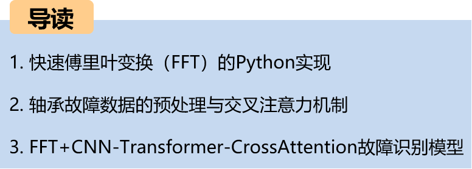
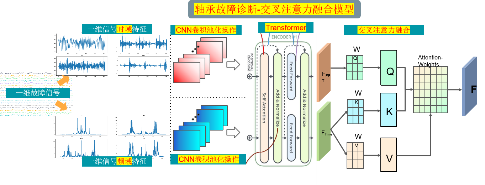
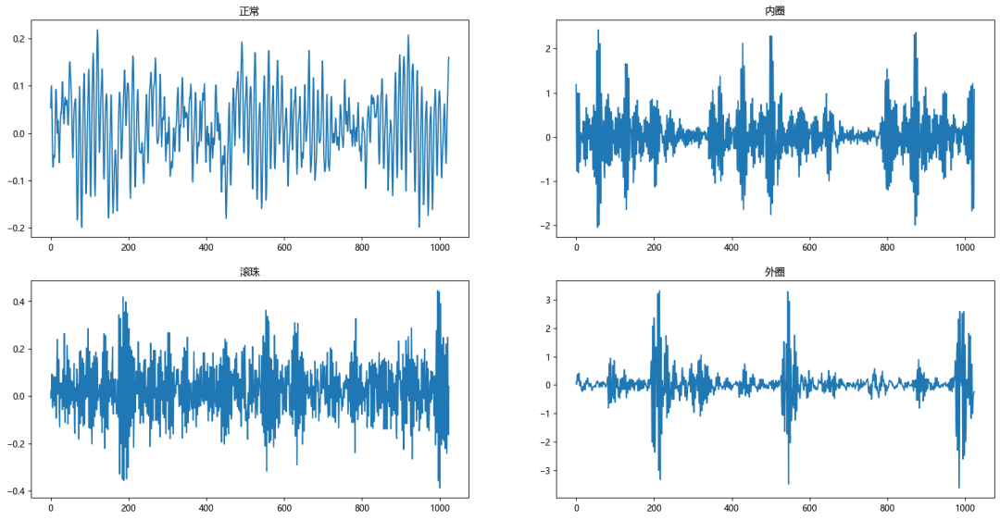
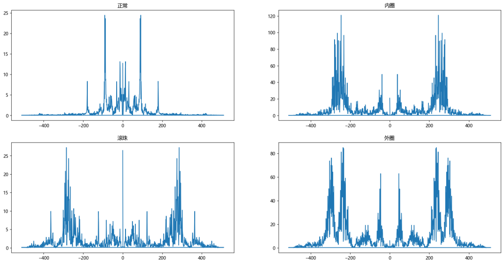
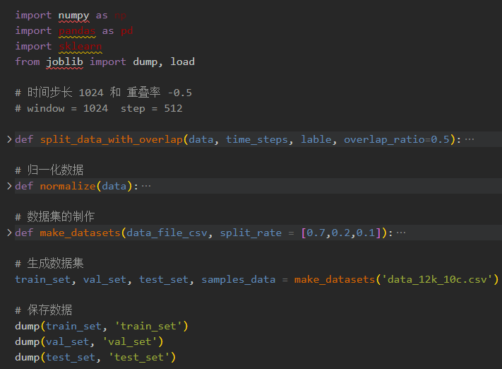
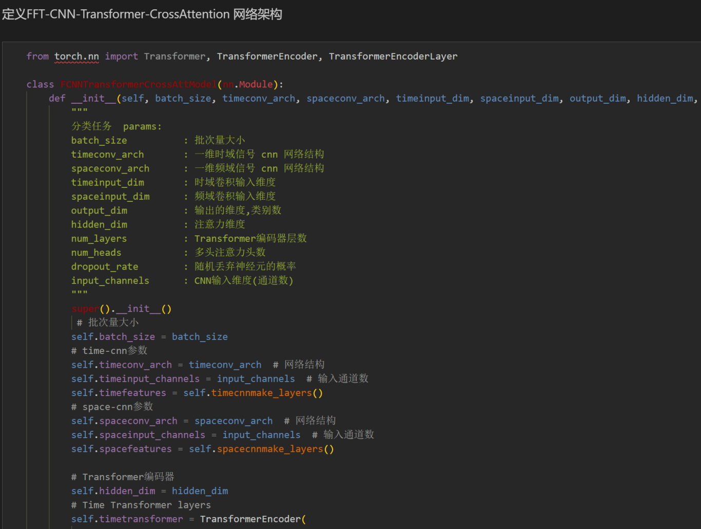
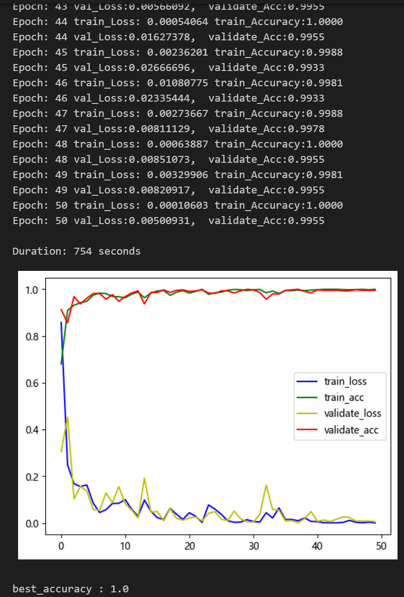
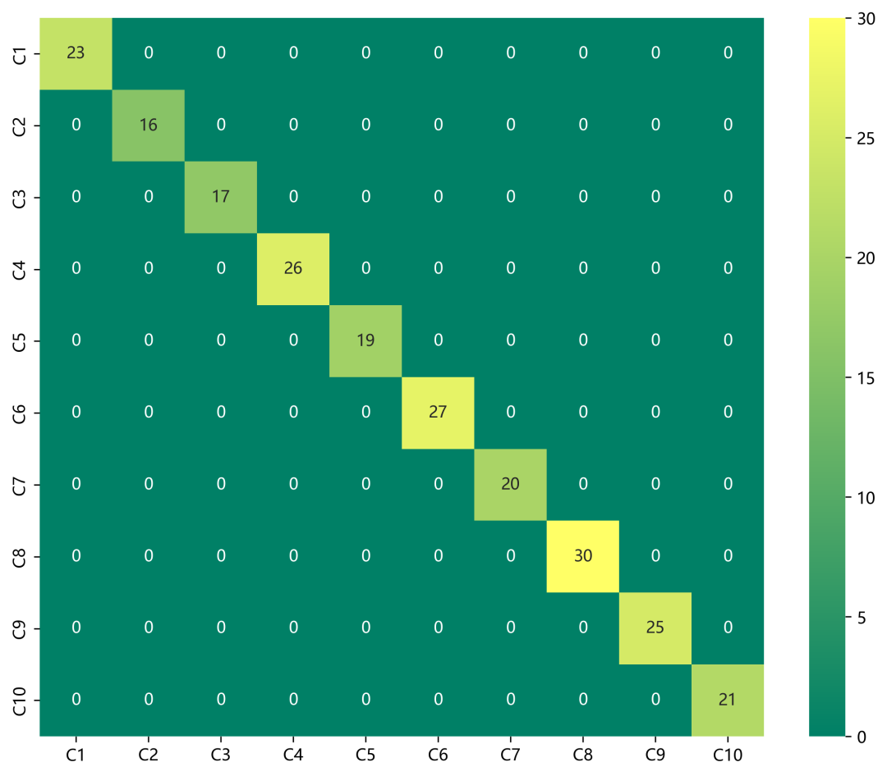
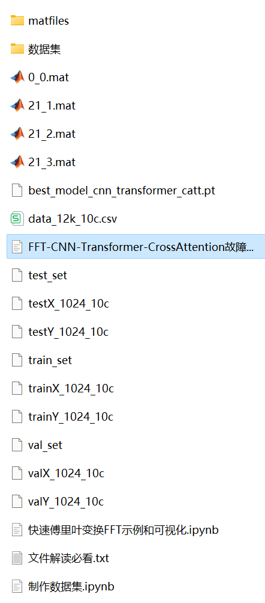
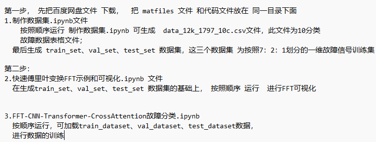

# Bearing Fault: FFT + CNN-Transform-CrossAttention Identification Model for Integrating Time-Domain and Frequency-Domain Features

Recommendation - Family Pack, higher cost-performance ratio!!  
Thesis innovation!!!  
The cross attention mechanism can model the correlation degree between different features. It extracts important features for model recognition from the frequency domain and time domain characteristics of fault signals, with significant effects.  
This includes a complete bearing fault dataset, as well as fault signal datasets, classification data, and label sets that have been generated and prepared. The corresponding codes can be run, along with examples of Fast Fourier Transform (FFT).  
With 50 epochs, an accuracy rate of 100%, the FFT+CNN-Transformer-CrossAttention network achieves significant results in classification. The model is capable of fully extracting spatial and temporal features as well as frequency domain features of bearing fault signals. The convergence speed is fast, and the performance is excellent. To date, it is the highest precision method among previous articles. Innovation also exists!!!  
Includes code for data preprocessing and the FFT+CNN-Transformer-CrossAttention classification code  
Environment: Python 3.9  
Innovation point: Using the cross attention mechanism to fuse models! Preface  
\tThis paper introduces the FFT and data preprocessing based on the CWRU bearing data, and finally implements the FFT-based CNN-Transformer-CrossAttention model for fault data classification using Python.  
Overall structure of the model  
\tThe overall structure of the model is as follows. A one-dimensional fault signal undergoes FFT transformation of its frequency domain features and the signal's own time domain features separately through CNN convolutional pooling operations to extract global features. Then, it goes through Transformer to extract time series features. With the use of the cross attention mechanism to fuse both time domain and frequency domain features, \tby calculating attention weights, the model focuses more on important features before enhancing them through feature fusion. Finally, it passes through a fully connected layer and softmax to output classification results.  
Time domain and frequency domain feature extraction:
Applying FFT to the time-domain signal to convert it into the frequency domain.
Utilize CNN for learning and extracting frequency domain features. The convolutional layers of CNN can capture local patterns in frequency domain features.
Transformer encoder layer:
Input the time-domain signal into the Transformer encoder layer. The Transformer encoder layer can effectively capture the long-term dependencies of the time-domain signal.
Cross-Attention Mechanism:
Utilize the cross-attention mechanism to fuse time-domain and frequency-domain features. This can be achieved by computing attention weights, allowing the model to focus more on important features.
1. Introduction to the Principle of Fast Fourier Transform (FFT)
\tThe Fourier Transform is a tool for signal processing and spectral analysis, used to convert a signal from the time domain to the frequency domain. The Fast Fourier Transform (FFT) is an efficient algorithm for implementing the Fourier transform, particularly suitable for the processing of discrete signals.
Step 1: Importing partial data
from scipy.io import loadmat  
import numpy as np  
import matplotlib.pyplot as plt  
import matplotlib  
matplotlib.rc("font", family='Microsoft YaHei')  
# Read MAT file
data1 = loadmat('0_0.mat')  # Normal signal
data2 = loadmat('21_1.mat')  # 0.021 inch inner ring
data3 = loadmat('21_2.mat')  # 0.021 inch roller
data4 = loadmat('21_3.mat')  # 0.021 inch outer ring
# Note: The data read out is in dictionary format, which can be checked through the function type(data).
Step 2: Visualization of fault signals
\t  
Step three, the fault signal is visualized through FFT.
\t  
2. Data Preprocessing for Bearing Faults
2.1 Import Data
Refer to the previous article for preprocessing of fault classification 10, and the Case Western Reserve University bearing data set: Classification 10 dataset.
\ttrain_set, val_set, test_set are all divided into training set, validation set and test set according to the ratio of 7:2:1, and finally save data.
The above figure is the form of data reading and the preprocessing ideas.
2.2 Creating the dataset and corresponding labels
3 Cross Attention Mechanism
\t3.1 Cross attentionConcept\tTransformerAttention mechanism with mixed embedding sequences in the architecture  
\tThe two sequences must have the same dimensions.
\tThe two sequences can be different patterns (such as: text, sound, image).
A sequence as input defines the output sequence length, and another sequence provides the input K&V.
3.2 Cross-attention Algorithm
\tCalculate K and V for S1.
Calculate Q for S2.
\tCalculate the Attention Matrix Based on K and Q
\tApply V to the Attention Matrix
The output sequence length is consistent with S2.
During the fusion process, we use the frequency domain features transformed by FFT as query sequences and time series features as key-value pairs. By calculating the attention weights between the query sequences and the key-value pairs, we can model the degree of association between different features.
4 Bearing Fault Identification Model Based on FFT+CNN-Transformer-CrossAttention
4.1 Network Definition Model
\t  
\tNote: The input fault signal data has a shape of [32, 1024], batch_size=32, where 1024 represents the sequence length.
\t4.2 Set parameters and train the model
\t50 epochs, accuracy 100%, using the FFT+CNN-Transformer-CrossAttention integrated network model for classification, the model significantly improves the classification effect by fully extracting spatial and temporal features as well as frequency domain features from bearing fault signals. It converges quickly, performs excellently with high accuracy and precision, and the cross attention mechanism models the correlation degree between different features, extracting important features for model recognition from both the frequency domain and time domain characteristics of the fault signal, resulting in noticeable improvements.
\t4.3 Model evaluation
\tAccuracy, Precision, Recall, F1 Score
\tFault classification confusion matrix:
\n        \n  

## Images

<!-- PAYMENT_BLOCK -->

## Get this dataset

- Payment link (Stripe): [Buy now](https://buy.stripe.com/3cs8yP7sY87d0vu9AB)
- Payment QR code: 

<!-- /PAYMENT_BLOCK -->
